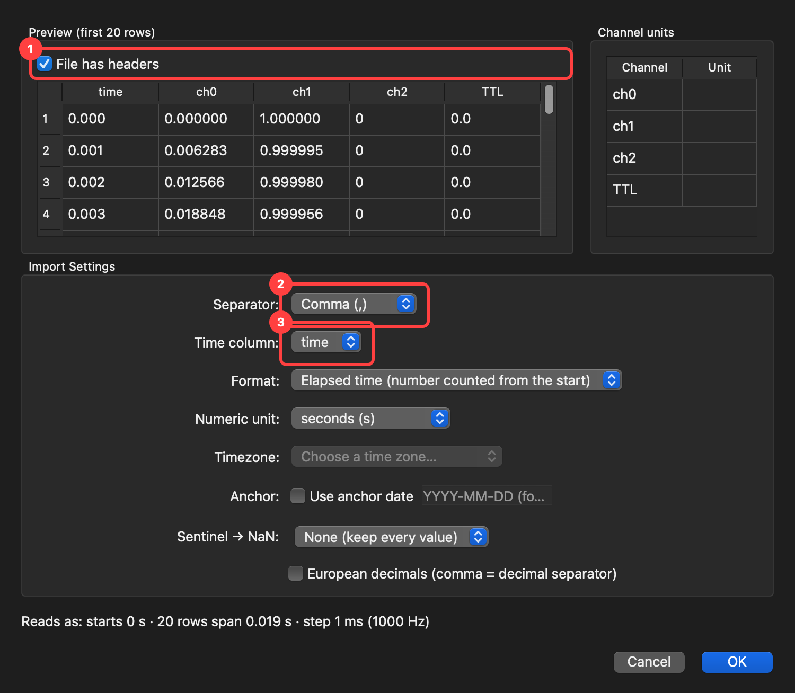
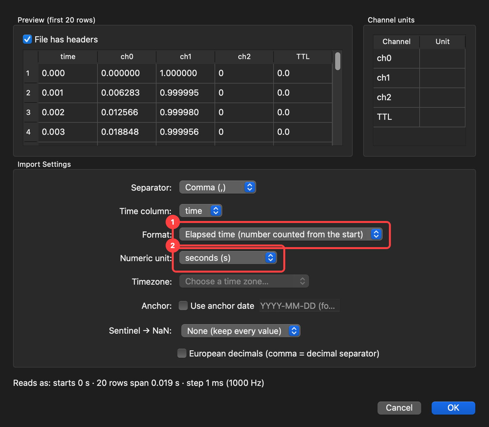
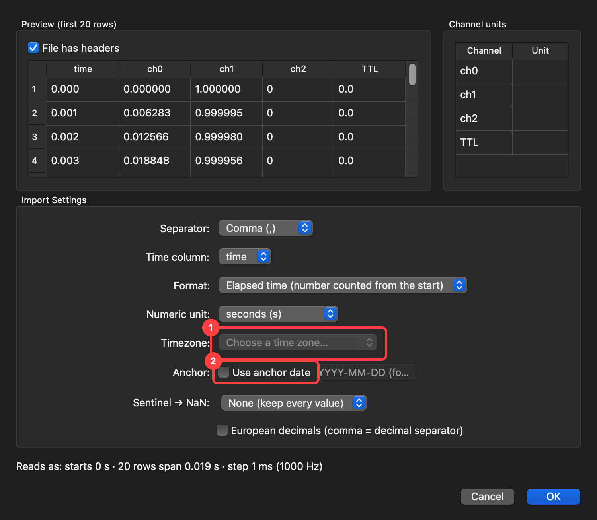
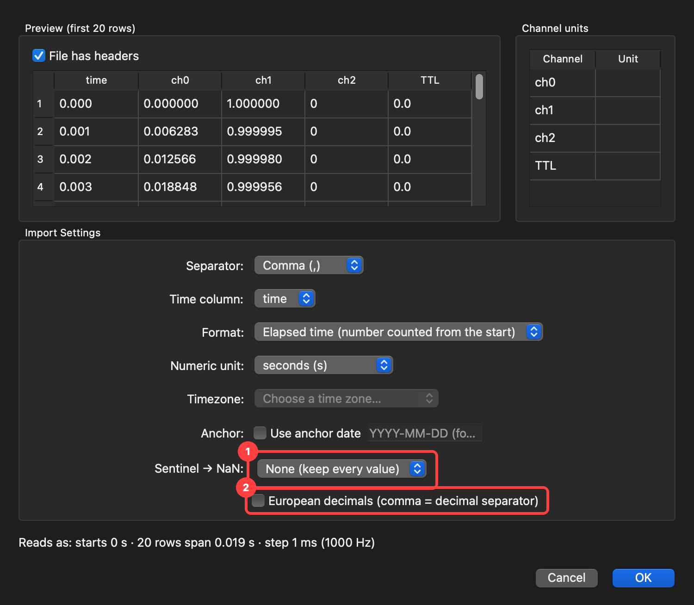

# Tutorial: import sensor and recording data

Video mostly describes itself. A table does not — a column of numbers could be seconds since the
recording started, milliseconds since midnight, or a Unix epoch in microseconds, and nothing in the
file says which. Guessing wrong shifts your data by hours without any visible sign that it happened.

The import wizard exists to make you state it. It shows the first twenty rows, and under the
settings a **Reads as** line says what those rows become with the current choices — the first time,
how long the preview spans, and the step and rate — so you can see the parse before anything is
cached.

## Structure: how to split the file

1. **File has headers** — tick when the first row is column names, not data. The preview
   updates immediately, which is the quickest way to check you got it right.
2. **Separator** — comma, semicolon, tab, space, or pipe. A guess is made from the file and shown
   selected; change it if the preview columns look wrong.
3. **Time column** — which column carries the timestamps. Everything else becomes a data channel.
   The guess looks for whole words such as `time`, `timestamp` or `t`, so `tail_x` is never taken
   for a clock.
4. **Channel units** — beside the preview, one row per channel. A header such as `force (N)` fills
   its own unit; type the rest (`mV`, `deg`). Units appear in the plot gutter and the Values panel.

## Time: what the numbers mean

1. **Format** — how to read the timestamp text. **Auto-detect** handles most files. The list covers
   **Elapsed time** (a number counted from the start of the recording), Unix epoch in seconds,
   milliseconds, microseconds or nanoseconds, ISO 8601 (with and without milliseconds),
   date-and-time in US and European order, and time-only. There is also a custom field for a
   `strftime` pattern of your own. A number is guessed from its size: below about three years'
   worth of seconds it is elapsed time, and a current date written in seconds, milliseconds,
   microseconds or nanoseconds is told apart by its digits.
2. **Numeric unit** — the unit an elapsed-time number counts in: seconds, milliseconds,
   microseconds, or nanoseconds. It is greyed for an epoch format, which names its own unit, and
   for date text.

This pair is where a silent hours-long error comes from. Read the **Reads as** line: if the start
is not the date you recorded on, or the step and rate are not your sampling rate, the format or
unit is wrong.

## Timezone: state it, never assume it

1. **Timezone** — UTC, local system time, or a named zone. **You must choose** whenever the
   timestamps are clock text that does not state its own offset: Import stays unavailable until you
   do. Numbers and text ending in `Z` or `+02:00` already fix the instant, so the field is greyed
   for them. A timezone-naive timestamp silently treated as UTC is the cause of real 1–2 hour "data corruption" reports in
   comparable tools, so AvialSync makes it an explicit decision rather than a default.
2. **Use anchor date** — for time-only columns (`10:30:00.000`) that carry no date at all. Supply
   the recording's date so the times land on the right day.

## Missing values and decimal commas

1. **Sentinel → NaN** — the value your logger writes to mean "no reading": `-9999`, `NaN`, `NA`,
   `#N/A`, or one you type. The default is **None**. It becomes NaN, which plots as a break in the trace instead of a real
   measurement. Nothing is converted unless you ask: AvialSync will not invent data the
   logger did not record, and will not silently turn a real `-9999` into a gap.
2. **European decimals** — tick when the file writes `1,5` for one-and-a-half. This also changes
   how the separator is read, so check the preview after toggling it.

## What happens after you accept

The file is parsed once and cached in AvialSync's cache folder: raw arrays plus the decimation
pyramid that keeps plotting responsive at 50 kHz. Later opens memory-map that cache instead of
re-parsing, so the second load of a large file is quick. Nothing is written into your data folder;
**File → Cache** deletes one trial's cache or all of it (see
[Data handling](../technical/data-handling.md)).

The cache key includes a content hash, not just the path and modification time. Editing the file in
Excel, or copying it across drives, invalidates the cache and triggers a rebuild — a stale cache in
a measurement tool is a trust problem, not a performance one.

## Review every dropped import

Every drop that produces one or more import candidates opens the batch review, whether you drop a
single file, several files, or a folder. Each row shows the file and detected type; confirm or change
the choice, skip a row, or adjust its role before importing. A file a session plugin named offers
only **Skip** or its own type, since the session already knows what it is; a loose file lists every
installed format. The **Use as** and **Calibration (XCP)** columns appear only while some row has a
pose role or a Vicon calibration to choose.

Session plugins still lay out recognized folders and provide shared timing, labels, and import
defaults. Their candidates appear in the same review as files recognized by individual loaders; a
plugin match never silently bypasses review.
