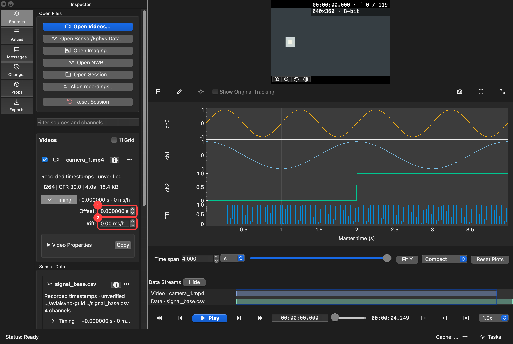
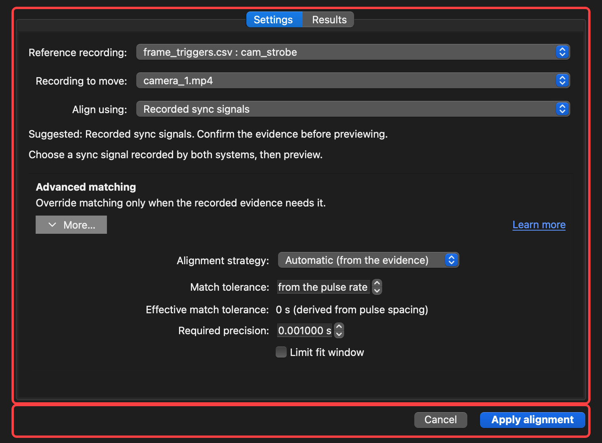
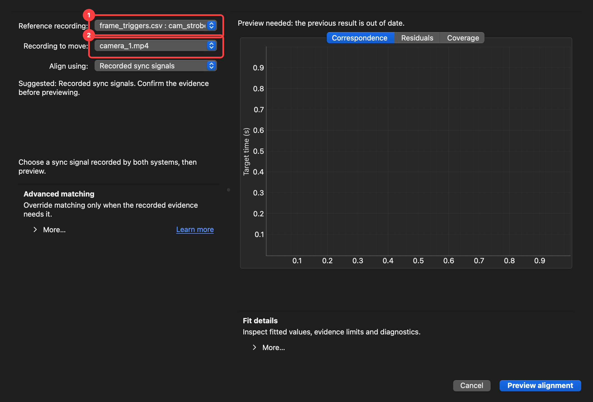
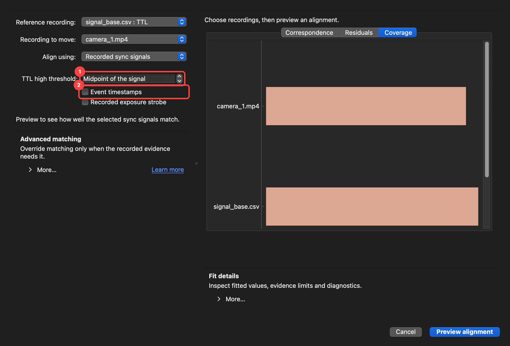
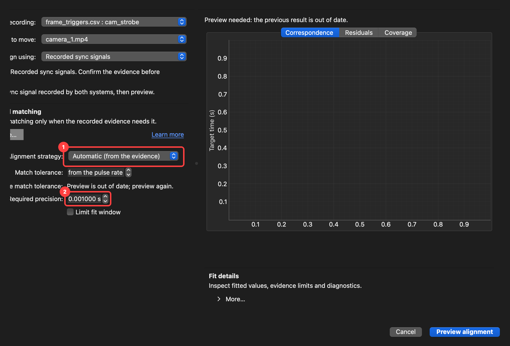
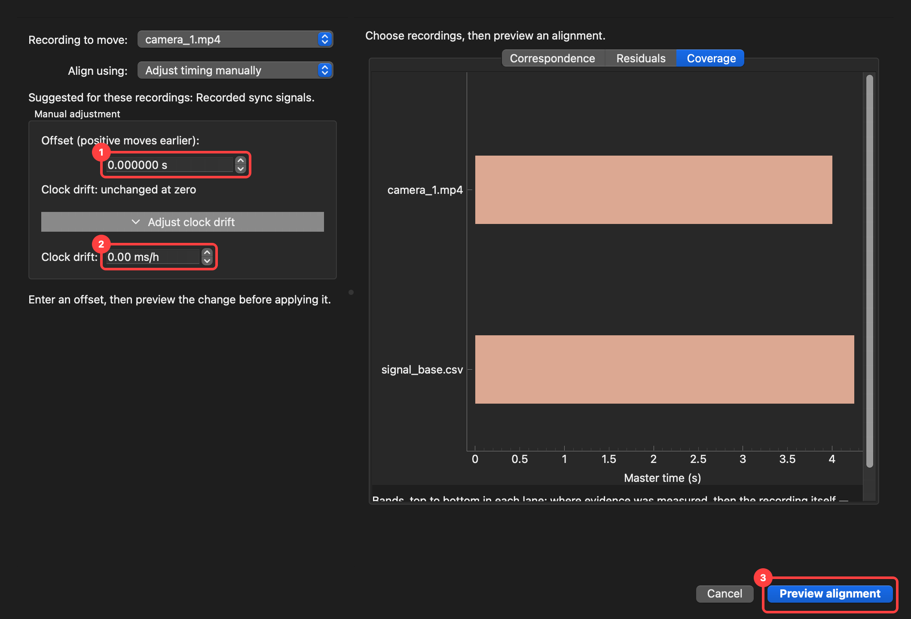
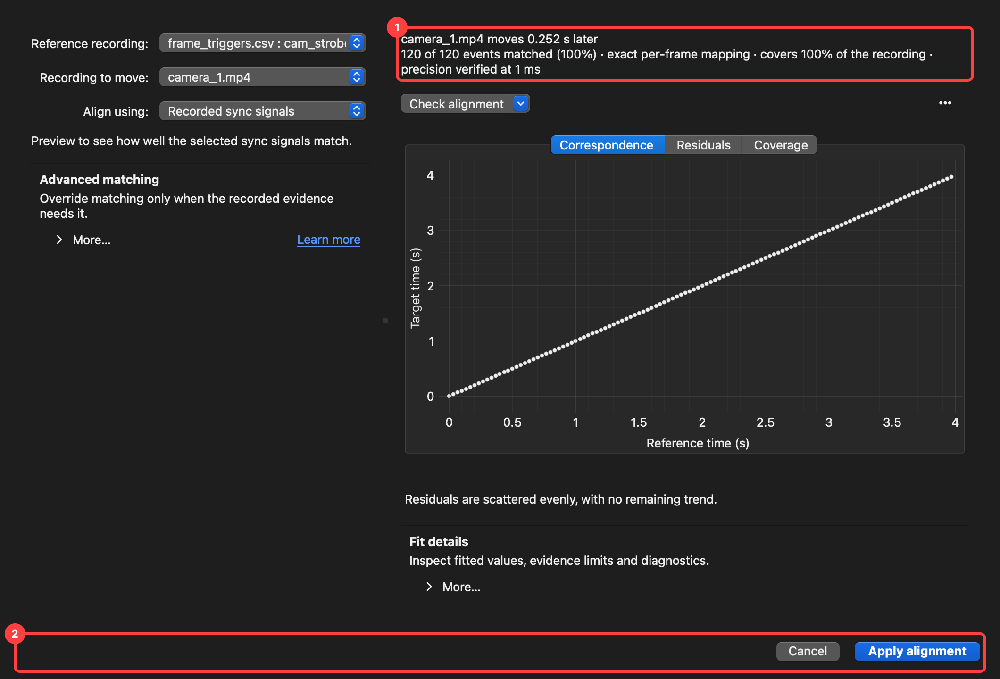
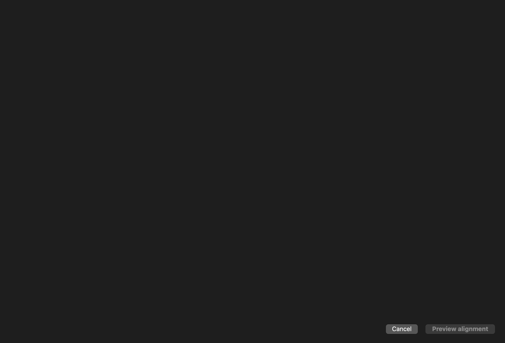

# Tutorial: align recordings

Recordings that came off independently-clocked hardware rarely agree. This walks through the ways
AvialSync fixes that, in the order you should try them: a manual offset, a drift correction,
evidence-based alignment from TTL pulses or camera frame triggers, and loading a trigger file so
AvialSync knows what your pulses are evidence of.

**Nothing here rewrites your files.** An alignment changes how AvialSync *reads* a recording onto
the shared timeline. The original stays byte-for-byte as the acquisition system wrote it.

## Before you start

Find an event visible in more than one recording: a flash, a movement, a pulse, a camera frame
trigger. That shared event is what you will judge alignment against.

Load your files first; [the first-session tutorial](first-session.md) covers that.

The screenshots use generated camera footage and frame-trigger evidence. Real recordings will show
their own source names, timing, and fit results.

## 1. A fixed offset, when one recording is simply early or late

Every source carries its own **Offset** and **Drift** in the left panel, behind the card's
**Timing** row, which shows both values while it is closed. Click it to edit them.

1. **Offset** adds seconds to the source time read at a given master time. Positive moves the
   recording **earlier**; negative moves it later. The alignment popup describes the actual
   direction of movement before acceptance. Use this when a camera started before or after the others.
2. **Drift** corrects a clock that runs fast or slow, as milliseconds gained per hour of
   recording (ms/h). A clock that gains 54 ms every hour has a drift of +54 ms/h; hovering the
   field also gives it in frames per hour for a camera. Use it when the
   recordings agree at the start and separate towards the end — a fixed offset cannot fix that,
   because the error grows with time. Cameras have this field too, so a camera that slips against
   the sensor is corrected where the problem is, rather than by drifting the sensor and moving it
   relative to every *other* camera at the same time.

Scrub to your shared event, adjust **Offset** until the views agree, then check a second event near
the *end* of the recording. If the two events need different offsets, the clocks are drifting and
you want **Drift** as well, or better still the evidence-based route below, which measures both.

To step a source one frame at a time, select it and use **Align → Nudge selected source
earlier** / **later** (`Ctrl+Shift+Left` / `Ctrl+Shift+Right`). Each press moves its offset by one
frame of that source; for less than a frame, type the offset. It steps the offset of the source
you selected — not whichever camera happens to be first — so you can keep your eyes on the video
while you adjust it.

## 2. Evidence-based alignment from TTL or frame triggers

When a recording carries repeated pulses — a TTL line, a camera exposure trigger, a frame-timestamp
log — AvialSync can fit the alignment from that evidence instead of you eyeballing it. Open
**Align → Align recordings…**.

The dialog does not block the window behind it. When a point on the evidence looks wrong, click it
and the master clock seeks there, so you can look at the footage before deciding whether to accept.
It stays inside the available screen. A narrow window uses full-height **Settings / Results** tabs;
a wider window shows both beside each other. Each page scrolls when needed, while the footer stays
visible. Increasing the font or opening **More…** does not push the actions off-screen. Keyboard
focus scrolls the selected control into view, and long rows wrap rather than widen the column, so
no label is ever cut off at the edge. Widening a narrowed window brings both pages back side by
side; narrowing it after a preview keeps **Results** in view.

Choose the reference and the recording to move first. Their session labels appear in the selectors;
duplicate filenames include up to three folders of context (or a number when the folders are the
same), and full paths are available in tooltips. The first reference offered is the one most likely
to carry sync pulses — a declared trigger file, then a channel named like `TTL`, `sync`, `strobe` or
`trigger` — rather than whichever channel is listed first. **Align using** starts on a method suited
to the loaded sources and names a different one only when it would suit them better; it never
declares exposure wiring for you.

Reopening the dialog after **Apply** offers the next recording that has no accepted alignment, so
a rig's cameras can be aligned one after another.

Choose **Align using → Recorded sync signals** for the following steps. **Correspondence**,
**Residuals**, and **Coverage** are separate evidence tabs; changing tabs does not change the fit.

### Choose what to compare

1. **Reference recording** — a recorded TTL channel or declared trigger train whose clock is already
   placed on the master timeline when it has an accepted mapping.
2. **Recording to move** — the video, imaging stack, sensor channel, or trigger file being aligned.

A video's presentation timestamps describe its own frames, but cannot establish when another
camera or the DAQ started. Two equal-rate videos can have identical timestamps and unrelated
physical starts. Record a shared event or camera exposure strobe to align them.

### Tell it how to read the reference

1. **TTL high threshold** — the level, in the channel's own units, above which a sample counts as
   a logical high. Left at *Midpoint of the signal*, it sits halfway between the channel's lowest
   and highest samples, which suits a 0–1, 3.3 V, 5 V or millivolt-scaled line alike; type a value
   if a spike or a fault skews that. This is how a continuous analogue trace becomes a list of
   pulse edges.
2. **Event timestamps** — check this when your reference is *already* a list of event
   times, such as a CSV of frame triggers, rather than a voltage to be thresholded. It disables the
   threshold, because there is nothing to threshold.
3. **Recorded exposure strobe** — check only if this channel contains pulses emitted by the
   selected camera for exposures that actually happened. Missing samples and incomplete pulses
   prevent an exact claim.
4. **Target TTL high threshold** — used only when the target is a sensor channel, whose levels
   need not match the reference's. Left at *Midpoint of the signal*, it sits halfway between that
   channel's lowest and highest samples; type a value if a spike or a fault skews that.

Changing any of these, or the reference or target, after a preview discards it: preview again
before accepting, so the mapping you accept is the one fitted to what is selected.

Getting this wrong is the most common cause of a poor fit: a threshold outside the signal's range
finds either no edges or every sample.

### Choose the strategy — or let the evidence choose

The strategy, match tolerance, required precision, and fit window are under **Advanced matching →
More…** in Settings. Numerical results and evidence limits are under **Fit details → More…** in
Results. Manual values have their own mode.

1. **Alignment strategy**
   - **Automatic (from the evidence)** — the default, and the one to use. It picks the strongest
     model this evidence actually supports, which is not a matter of preference: whether the
     recording is long enough to measure a rate, and whether the pulses identify frames, are facts
     about the data rather than choices. See [what it picks between](#what-automatic-picks-between).
   - **Affine fit (offset and drift)** — forces a fitted offset and rate across all matched events.
   - **Exact index (1:1 frame mapping)** — forces mapping video frame *n* to reference event *n*.
     Only correct when the reference genuinely records each exposure that *happened*; if it records
     each exposure that was *requested*, a dropped frame shifts everything after it.

Exact index pairing starts at the first stored frame. A shifted index cannot prove frame identity,
so the popup does not offer an index-offset control. Use explicit corresponding events instead.

### Set the tolerance, if the default is not good enough

**Match tolerance** is how far apart two events may be and still count as the same event. Left
blank it is derived from your pulse rate — a quarter of the interval between events — which is a
rule about telling one pulse from the next, not about the precision your work needs. On a 1 Hz sync
pulse that is 250 ms, and it will accept a 100 ms misalignment without complaint.

Both are entered and shown in milliseconds, like the residuals they are compared with. Set
**Required precision** separately. The search tolerance finds candidate pairs; the precision
requirement checks their residuals, coverage, the largest interval without a match, and any
extrapolation. Sparse evidence remains usable with a visible **precision unverified** state, and the
result names the check that failed — for example that 40 s of the recording lies beyond the matched
events, where clock wander could exceed the requirement.
For sampled signals it also checks the observed sample spacing: a 100 Hz TTL recording cannot
establish 1 ms precision from small fit residuals. These checks describe recorded timestamps;
unmeasured camera latency, exposure timing, and visual observation error are not certified.

### Fit only part of a recording

Tick **Limit fit window** and drag the shaded window on the Residuals tab. Use it when
the start or end of a recording is unusable — a settling period, a cable knocked mid-session.

A fit over part of a recording claims nothing about the rest, so the window is written into the
record and reported wherever the alignment is shown. Outside it, the alignment is an extension of a
trend measured elsewhere, which may well be right and is a different statement.

### Or set the mapping by hand

Choose **Align using → Adjust timing manually**. The fields start from the selected recording's
current correction. If you already know the numbers, enter them directly instead of fitting.
The result area keeps **Coverage** visible to show where the recordings sit; evidence-only
**Fit details** are hidden in this mode.

1. **Manual offset**, in seconds.
2. **Adjust clock drift** reveals the rate correction, in milliseconds gained per hour (ms/h).
   Its existing value is always stated; collapsing the control preserves it.
3. **Preview alignment** creates a proposal, which you still apply explicitly.

Manual corrections preserve an existing exact or interpolated timing relationship. Only its
position/rate correction changes; Undo restores both the previous timing and its evidence status.

A manual mapping is recorded as set by hand, and reported that way everywhere afterwards. It is
never dressed up as a measurement: a number you typed has no residual, no matched events, and no
uncertainty, and the session says so rather than quoting zeros that would read as perfect.

### Read the evidence before accepting

1. **Preview alignment** in the footer extracts the evidence, matches events, and fits the mapping.
  On narrow screens it opens Results. The first line names the recording and how far and which way
  it moves — at the start and at the end, when drift makes them differ. The second line gives the
  numbers it is judged by without expanding anything: events matched out of those the recording
  could have captured, RMS and worst residual, drift, coverage, and whether precision is verified
  (and if not, why). The effective match tolerance, and whether it was derived from pulse spacing
  or set by you, is under **Advanced matching → More…**; an exact per-frame mapping uses none.
  Changing the tolerance invalidates the preview, so run it again before accepting. Three panels
  show what it found; read them in order, because they answer different questions. Before the
  first preview, **Coverage** is shown, since it is the one view with content already.
2. **Apply alignment** replaces Preview when a current proposal is ready. Until you activate it,
   nothing has changed. A proposal is never applied silently. When the evidence cannot support a
   proposal, the result says **Cannot apply** and why, and opens **Fit details** at the reason;
   Preview remains available. Return only activates the focused Preview/Apply button; an arriving
   result cannot turn a repeated Return into acceptance, and a double-click on Preview does not
   apply the result it produced. A manual preview that leaves the recording where it already is
   cannot be applied. After Apply, the status bar says what was aligned and that **Edit → Undo**
   reverts it.

Changing settings or source timing invalidates the preview; an older background result cannot
become the current proposal. The plots stay so a fit window can still be chosen from them, marked
**Previous preview — out of date** until you preview again. Changing a reference also flags accepted downstream alignments for
review. The source cards distinguish recorded timestamps, manual timing, shared or visual events,
verified/unverified precision, and alignments needing review.

**Correspondence.** Reference time against the target time each event was matched
to, with a dashed one-to-one guide behind it. A correct alignment is a dense diagonal lying along
the guide, with clean margins. This is the panel that shows whether the *pairing* is right, and it
is the one to read first.

- Points diverging from the guide mean a rate difference.
- A line parallel to the guide but displaced means the whole train was matched at the wrong lag —
  which happens with uniform pulse trains, and which no residual can reveal.
- Ink along the margins is rejected evidence, drawn where it sits in time. A margin that is mostly
  solid means most of your events found no partner.

The match rate counts only the reference events that fall inside the recording being moved once
mapped: a camera that ran for a fifth of a long DAQ session is judged on the pulses it could have
recorded, not refused for the four fifths it never saw.

**Residuals.** How tightly the matched pairs agree, against the search-tolerance
band. Residuals do not prove physical precision between sparse events. The summary reports the
separate precision check and the largest unsupported interval.

**Coverage.** Where each recording has data, where its alignment was actually
measured, and where the recording stops and resumes. The distinction that matters: between the
first and last sync point the alignment is measured, and outside them it is extended. Both may be
right; they are different claims, and a source with no accepted evidence is marked as extended
along its whole length.

### What "Automatic" picks between

In descending order of strength, whichever the evidence supports:

- **Exact** — a recorded camera-to-DAQ exposure strobe declared for that camera, with matching
  stored-frame count, complete pulses, and agreeing interval pattern. Each frame takes the time
  its own exposure was measured at. Local video timestamps alone never license this mapping.
- **Interpolated between sync edges** — a shared pulse train. The mapping follows the two clocks at
  every edge, so no single rate has to hold across the whole recording. This is the answer when
  clocks wander unpredictably, as they do when a room warms up.
- **Offset and drift** — a fitted rate, where the recording is long enough for a rate to be
  measurable at all.
- **Offset alone** — where it is not. A drift fitted over a span too short to show it is not a
  measurement of a clock; it is noise in a parameter, and AvialSync declines to quote it.
Automatic event matching needs at least three events on both sides. To place a recording from
one or two events, explicitly pair the corresponding observations using the visual-event mode below;
those sparse placements are recorded as unvalidated.

Accepted mappings are saved with the session, so a colleague can see what was applied and on what
evidence.

## Align from corresponding visual events

Choose **Align using → Match visible events** when both recordings show a recognizable
event and no shared TTL evidence is available. This mode also works between two independent videos;
their local frame timestamps alone are never treated as evidence of a shared start.

1. Choose the reference recording and the recording to move.
2. Scrub to the event in the reference and choose **Capture reference**.
3. Scrub to the same observed event in the target and choose **Capture target**.
4. Choose **Add pair**. Capture uses the actual stored frame time for video or imaging. You can
   also enter times explicitly in each recording's original clock.
5. Repeat at separated points. Set **Observation resolution** to reflect how precisely the event
   can actually be identified, then preview and inspect the proposal before accepting.

One pair establishes an offset. Two separated pairs determine an offset and rate but leave no
independent check, so both sparse cases remain **unvalidated**. Additional pairs expose residuals;
observation resolution still limits any precision claim. Remove a mistaken pair explicitly rather
than asking the matcher to silently discard it. Changing either recording clears its pairs.

Imaging stacks appear alongside videos and sensors as targets. Their accepted mapping follows the
same session, undo/redo and precision rules. Frame-indexed tracking attached to a camera retains
that camera's frame timing rather than creating another independent alignment.

## 3. Load a trigger file, and say what its lines are

A TTL file is often separate from the data: a DAQ export with a time column and one or more logical
lines, or a camera's own log with one timestamp per exposure. Open **Align → Open Trigger
Evidence…** and pick it.

AvialSync reads the header, offers every column that looks like a trigger line, and asks the one
question the file cannot answer: **which way the wire ran.**

- **Camera exposure strobe** — the camera emitted a pulse per exposure it actually took. Pulse
  count is frame count, a dropped frame shows as a gap in the train, and each frame can be given
  the time its own exposure was measured at.
- **External frame trigger** — a pulse generator asked the camera for each exposure. This records
  the request, not the result. A frame the camera dropped looks exactly like one it kept, so
  pairing by index would shift everything after the loss. Counts agreeing does not rescue it: a
  drop plus a duplicate agree too.
- **Shared sync pulse train** — a square wave both systems recorded, far sparser than the frame
  rate. Enough to follow the two clocks wherever they wander; not enough to identify a frame.
- **Sparse landmarks** — a start pulse, a stop pulse, a switch thrown by hand. Enough to place a
  recording, rarely enough to check the placing.

**Nothing is pre-selected as a strobe.** Whether those pulses came from frames that happened is a
fact about your wiring, and it decides whether an exact per-frame mapping is allowed — so it is the
one thing AvialSync will not assume on your behalf. Everything is offered as a sync train until you
say otherwise.

One file can carry several lines, each about a different camera. Name the source each one is
evidence about, and it will be offered on the right side of the wizard. What you declared is saved
with the session; the pulses themselves are re-read from the file, so a file corrected on disk is
read as it now is.

The trigger-file dialog lets you choose sampled signals or event timestamps per column, the time
column and units (seconds, milliseconds, microseconds), logical-high threshold, and minimum pulse
interval in seconds. A one-column timestamp CSV is offered as an event list. Suggested units and
declarations remain visible for review; nothing is declared an exposure strobe automatically.

If a train skips beats, AvialSync says so when it loads. That gap is the evidence frames were lost,
and the reason an index-paired mapping would be wrong.

### If your rig emits a perfectly uniform train

A uniform pulse train fits at *every* multiple of its period, and no residual can tell those
alignments apart — a fit off by one whole period looks exactly as good as the right one. AvialSync
refuses rather than guessing when two lags fit equally well.

The fix is at the rig: make the pulses distinguishable. Jittered intervals, or a periodically
doubled pulse, give the alignment a single unambiguous answer.

## 4. Check the result

Alignment that looks right at the event you used to align it proves very little.

**Check alignment → Beginning / Middle / End** seeks to actual paired evidence while
leaving the recording window available. The result's **More choices (⋯) → Export report…** writes the current proposal and mapping
as JSON. After acceptance, **Align → Export Alignment Report…** exports accepted records and their
current evaluated mappings, including manual corrections. Reports identify whether they describe
a proposal or an accepted result; saved sessions retain a bounded match sample, and the report
explicitly says whether that sample is complete.

Window size and expanded sections are remembered. Recording and method choices are retained only
within the current session; resetting the session starts fresh. Reopening alignment always needs a
new preview: event pairs, thresholds, exposure declarations, manual values and proposals are never
restored from these UI preferences. Accepted timing still comes from the session document.

- Move to several events **across the whole recording**, especially near the beginning and end.
  Drift shows up at the edges.
- **Data Streams** shows when each source has data; the video and plot panes show the aligned
  content itself.
- With an **exact** or **interpolated** mapping accepted, scrubbing, pausing, and frame-stepping all
  land on the accepted trigger timestamps, and every video seeks from the same master trigger while
  keeping its own original presentation timestamps.
- Each source's badge in **Data Streams** says how it is aligned, including when it is not aligned
  at all. Moving a source by hand after accepting a fit supersedes that fit: the record is kept so
  you can see what it was, and marked so nothing reports a residual for a mapping it stopped using.

If a camera has no coverage at the selected time it shows **No Footage** instead of a stale frame.
That is correct behaviour, not a fault.
